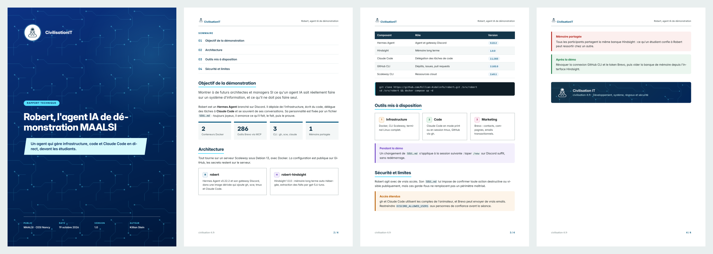

# Kit PDF Civilisation IT

Kit pour agents IA (Claude Code, Hermes Agent…) qui génère des PDF corporate aux couleurs de [Civilisation IT](https://civilisation-it.fr) : rapports, propositions, comptes rendus, devis, fiches techniques.



L'IA écrit le document en HTML à partir d'un gabarit, puis Chrome/Chromium le rend en PDF A4 : page de garde à motif circuit, en-tête avec logo, pied de page numéroté, typographie Inter, composants repris du site (cartes, encadrés, chiffres clés, tableaux, étiquettes).

## Contenu

| Chemin | Rôle |
|---|---|
| `SKILL.md` | Instructions pour l'IA : démarche, catalogue des composants, règles de mise en page |
| `templates/document.html` | Gabarit par défaut, à copier pour chaque document |
| `templates/civilisation-it.css` | Mise en page A4 et composants |
| `brand/tokens.css` | Couleurs, polices et formes de la charte |
| `brand/BRAND.md` | Charte : logo, palette, typographie, motifs |
| `brand/logo/` | Logo en marine, noir, blanc et format en-tête |
| `brand/fonts/` | Inter (variable, licence OFL) |
| `scripts/render.sh` | HTML → PDF avec Chrome/Chromium headless |
| `examples/rapport-robert.html` | Exemple complet, et son PDF |

## Utilisation

```sh
cp templates/document.html ~/mon-rapport.html   # puis remplir
scripts/render.sh ~/mon-rapport.html            # écrit ~/mon-rapport.pdf
```

Seul prérequis : Chrome ou Chromium. Le script le trouve tout seul sur macOS, sur Linux et dans Hermes Agent ; sinon, `CHROME=/chemin/vers/chrome`.

## Installer le skill

**Claude Code** :

```sh
git clone https://github.com/Killian-Aidalinfo/civilisation-it-pdf-kit.git ~/.claude/skills/civilisation-it-pdf
```

**Hermes Agent** :

```sh
git clone https://github.com/Killian-Aidalinfo/civilisation-it-pdf-kit.git ~/.hermes/skills/productivity/civilisation-it-pdf
```

Ensuite, il suffit de demander « fais-moi un PDF corporate Civilisation IT sur… ».

## Licences

- Code (CSS, gabarits, scripts) : MIT, voir `LICENSE`.
- Logo et nom Civilisation IT : propriété de Civilisation IT, utilisables uniquement pour des documents de Civilisation IT.
- Police Inter : SIL Open Font License 1.1, voir `brand/fonts/Inter-LICENSE.txt`.
